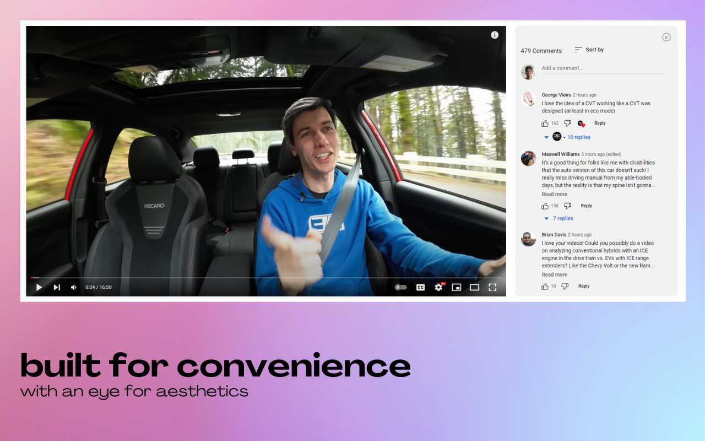
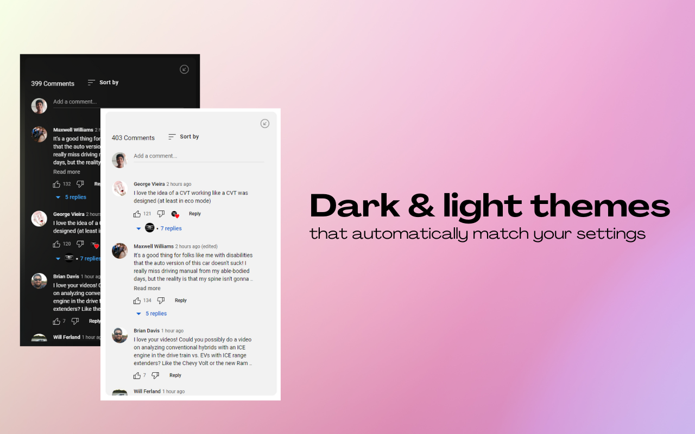
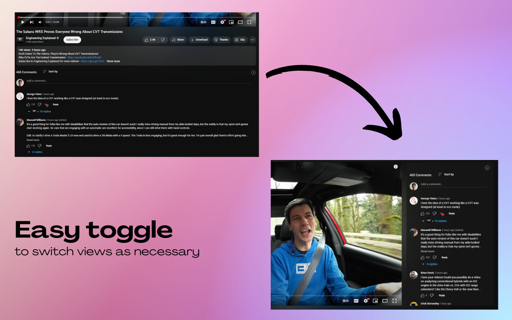

# Sidesy: Your Comments Sidebar For YouTube

A Google Chrome extension that brings the comments section to the sidebar, enabling users to dive into the comments without scrolling past the video.


## Installation

1. [Chrome App Store](https://chrome.google.com/webstore/detail/sidesy-bring-youtube-comm/mlceikceecooilkgiikkopipedhjjech)
2. [Local Installation](#local-installation)

## Features

1. Built for convenience with an eye for aesthetics. Unlike other similar options in the market, the sidebar comments don't feel out of place. They look nice and work well.
2. Dark & light modes depending on your YouTube settings.
3. Easy toggle integrated right into the comments section to easily switch between default and sidebar views.

## Showcase





## Local Installation

1. Clone the repo
2. Navigate to `chrome://extensions/` on a Chromium-based browser (Popular browsers: Google Chrome, Brave, Edge)
3. Turn on `Developer Mode` at the top right of the window.
4. Click on `Load Unpacked` on the top left, and navigate to the repo on your machine.

## Live YouTube E2E tests

The `Live YouTube E2E` GitHub Actions workflow loads the real unpacked extension
in Chromium and visits a public YouTube video. It runs daily at **09:47 IST
(04:17 UTC)**, on relevant pull requests, and manually from the Actions tab.
Scheduled runs start after the workflow is merged into the default branch;
GitHub may delay scheduled runs. No Google account or secrets are required.

The first suite covers both saved comment positions, toggling positions and
restoring the last position after navigation/reload, the registered Chrome
position shortcut, and expanding/collapsing with the button and `Z` shortcut.
It also checks that `Z` does not toggle comments while typing in YouTube search
or while comments are below the video.

On Linux, install Node.js 22+, then run:

```sh
npm ci
npx playwright install --with-deps chromium
sudo apt-get install -y xdotool
xvfb-run --auto-servernum --server-args='-screen 0 1920x1200x24' npm run test:e2e
```

Each test gets a fresh browser profile with the actual extension APIs and a
known saved placement. Chrome's position shortcut is exercised with native X11
key input through `xdotool`, including the background worker's command handler;
it is not simulated by sending a runtime message. Use an isolated X display, as
the shortcut helper expects one visible Chromium window. The shortcut test is
skipped on macOS/Windows; the other tests can run there after installing Chromium.
Set `E2E_HEADLESS=1` for a local headless run of the other tests. The full suite
requires headed Linux/Xvfb.

The default video is “Me at the zoo.” Override `YOUTUBE_VIDEO_URL` locally or
the manual workflow's `video_url` input if it becomes unavailable. The tests
use live pages without mocking YouTube responses or injecting content scripts.
Consent screens are handled in English. Disabled comments, login/bot challenges,
unavailable videos, and extension failures all fail the run rather than silently
passing. Review the failure screenshot, live DOM, browser log, and Playwright
trace in the uploaded artifact to distinguish a compatibility regression from
a blocked test environment. This first suite does not cover signed-in features
such as Ask or every regional/experimental YouTube layout.

Download a workflow artifact and open its HTML report, or run
`npm run test:e2e:report` after a local run. In GitHub notification settings,
enable Actions notifications for failed workflows to receive daily-run failures.
